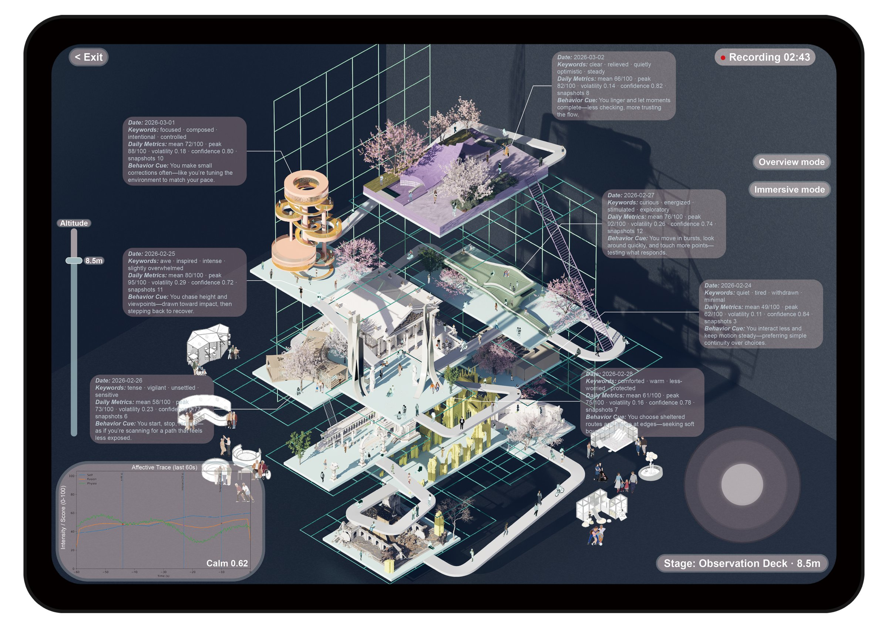
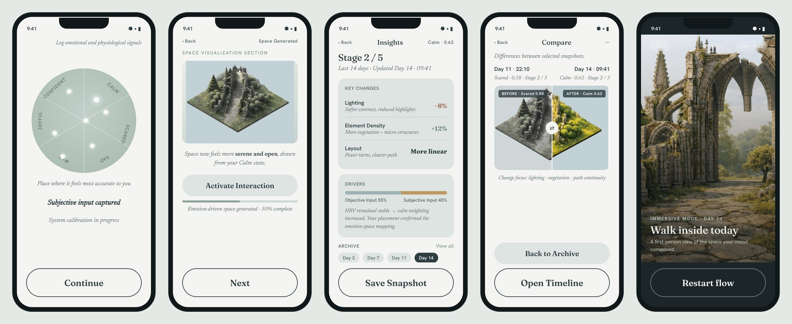
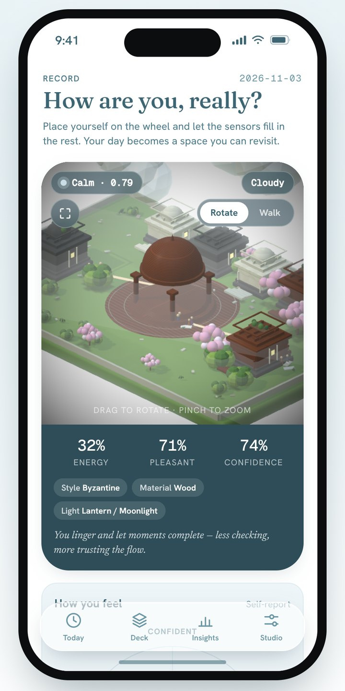
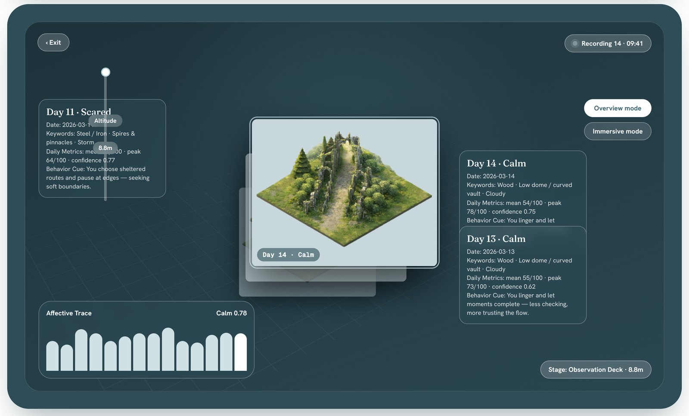
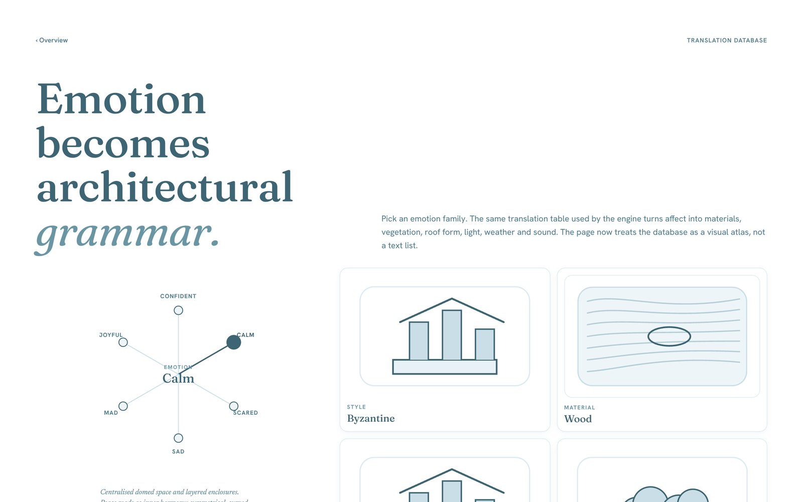
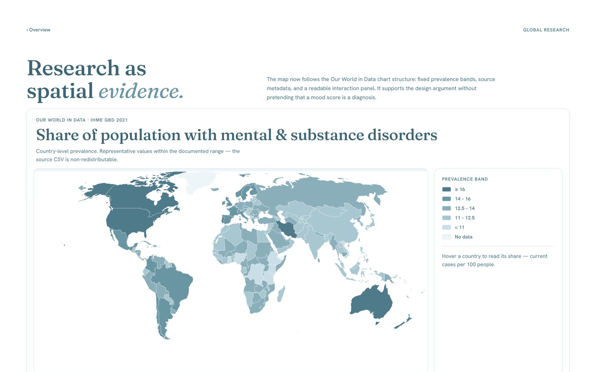

# Mood Builder

**A mobile concept that turns how you feel each day into a small space that grows, and stacks those days into a record you can walk back through.**

[**Live demo**](https://mood-builder-ziyuzhao.netlify.app/) · [**Clickable mobile prototype**](https://mood-builder-ziyuzhao.netlify.app/prototype/) · [Design system](DESIGN-SYSTEM.md) · [Process notes](process/)



---

## The idea

Mood trackers usually end in a chart. Mood Builder ends in a place.

Each day you place yourself on an emotion wheel, and a few body signals (heart-rate variability, resting heart rate, skin conductance, movement) fill in the rest. The app fuses the two into one emotion reading, then translates it into architecture: a style, a material, light, vegetation and weather. That becomes a small isometric space for the day. Over weeks the days stack into an **Observation Deck** you can compare, get gentle insights from, and step inside.

The voice is calm and observational, closer to a field notebook than a fitness app: no exclamation marks, no cheerleading, no alarm colours.

> Mood Builder is a design concept, not a medical or diagnostic tool. In the demo the body signals are sliders you set yourself.

## Try it

| | What to look at |
| --- | --- |
| [**The app**](https://mood-builder-ziyuzhao.netlify.app/app/) | The core loop: set the wheel and signals, watch the 3D space recompose live, save a snapshot (kept in your browser only). Drag to rotate, or switch to *Walk*. |
| [**Mobile prototype**](https://mood-builder-ziyuzhao.netlify.app/prototype/) | The full 10-screen flow: observe, record, calibrate, generate, adjust, temporal record, insights, compare, immersive. Use ← → or the dots. |
| [**Observation Deck**](https://mood-builder-ziyuzhao.netlify.app/deck/) | Fourteen days of engine output stacked as platforms, with an altitude slider and an affective trace. |
| [**Translation database**](https://mood-builder-ziyuzhao.netlify.app/translation/) | How each emotion family maps to material, roof form, light, weather and sound. |
| [**Research**](https://mood-builder-ziyuzhao.netlify.app/research/) | Why the project exists: the global mental-health burden, as an interactive map. |
| [**Logic**](https://mood-builder-ziyuzhao.netlify.app/logic/) | The closed translation loop, from inputs to design output. |



## My role

Design by **Ziyu Zhao**: concept, research framing, the emotion-to-space translation system, the mobile flow, the design system (colour, type, spacing, components) and the visual direction.

The web app was built with AI coding assistants, **Claude Code** and **Codex**. I set the direction and the quality bar, and ran a build, review, decide loop between the two: one builds, the other reviews against a single brief, and I make the call. The written handoffs between them are in [`process/`](process/).

## How it works

```
Subjective input (emotion wheel)  ─┐
                                   ├─► Emotion State Engine ─► Spatial State Engine ─► Temporal layer
Objective input (body signals)    ─┘   normalise · weight &     parameters · domain       snapshot · compare ·
                                       fuse · map · calibrate   rules · compose           archive · insights
```

- **Emotion State Engine** fuses the two inputs into one emotion vector. Body signals count for less while you are moving, and the confidence score reflects how closely the wheel and the body agree (`webapp/lib/engine/evolution-engine.ts`).
- **Translation database** maps each emotion family to an architectural vocabulary: style, material, roof, light, weather, soundscape (`webapp/lib/engine/translation-db.ts`).
- **Composer** turns those parameters plus a seed into massing, vegetation and paths. It is deterministic, so the same reading always rebuilds the same space (`webapp/lib/engine/composer.ts`).
- **Temporal layer** stores daily snapshots on the device and stacks them into the deck.

<table>
  <tr>
    <td width="34%"></td>
    <td><br><br></td>
  </tr>
</table>



## What's in this repo

| Path | What |
| --- | --- |
| [`webapp/`](webapp/) | The web app: Next.js 16, React 19, TypeScript, Three.js via react-three-fiber. Exports as a fully static site. |
| [`Mood Builder - Prototype.html`](Mood%20Builder%20-%20Prototype.html) | The 10-screen mobile prototype as one self-contained file (source in [`ui_kits/mood-builder-app/`](ui_kits/mood-builder-app/)). Open it from the repo root. |
| [`tokens/`](tokens/), [`components/`](components/), [`guidelines/`](guidelines/), [`styles.css`](styles.css) | The design system. Start with [`DESIGN-SYSTEM.md`](DESIGN-SYSTEM.md). |
| [`assets/`](assets/) | Self-hosted fonts and the render boards. |
| [`process/`](process/) | Working notes: AI handoffs, Figma build notes, the render-asset spec. |
| [`docs/screenshots/`](docs/screenshots/) | Images used in this README. |

## Run it locally

```bash
cd webapp
npm install
npm run dev            # http://localhost:3000
npm run check          # type-check + production build
npm run build:static   # static site in webapp/out/ (what the live demo serves)
```

The live demo deploys from this repo on Netlify using [`netlify.toml`](netlify.toml). Fonts, renders and the world map are all self-hosted, so nothing loads from a third-party CDN.

## Status

- **v1 (this repo):** the concept, the design system, the 10-screen prototype and a working web build of the core record-to-space loop.
- **Known limits:** body signals are simulated with sliders; snapshots live in one browser's local storage; the app composes from three placeholder renders until the layered render library exists ([spec](process/RENDER-ASSET-SPEC.md)); the research map uses representative values within the published range, not an exact copy of the dataset.
- **Next:** a 2.0 redesign of the core flow is in progress. This repo will be updated when it lands.

## Credits

Research data: IHME, Global Burden of Disease (2021), via [Our World in Data](https://ourworldindata.org/grapher/share-with-mental-and-substance-disorders). Map geometry: [world-atlas](https://github.com/topojson/world-atlas) (Natural Earth). Typefaces: Fraunces, Newsreader, Hanken Grotesk, Geist (SIL Open Font License).
